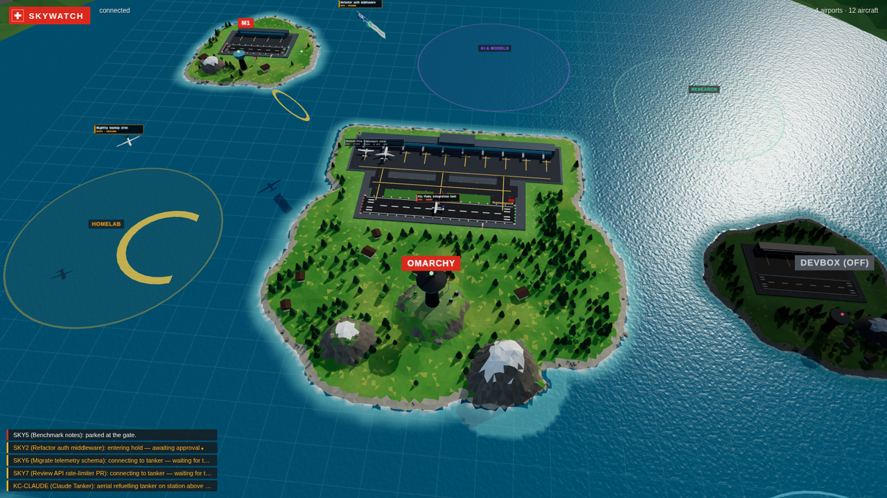
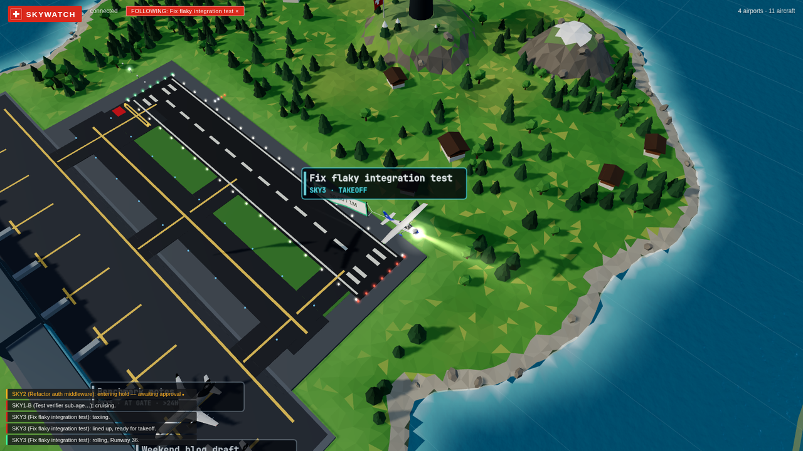
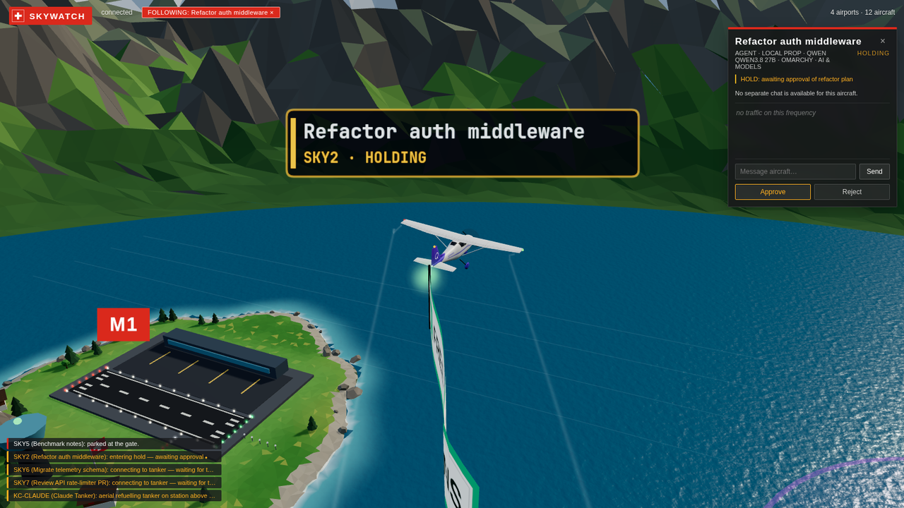
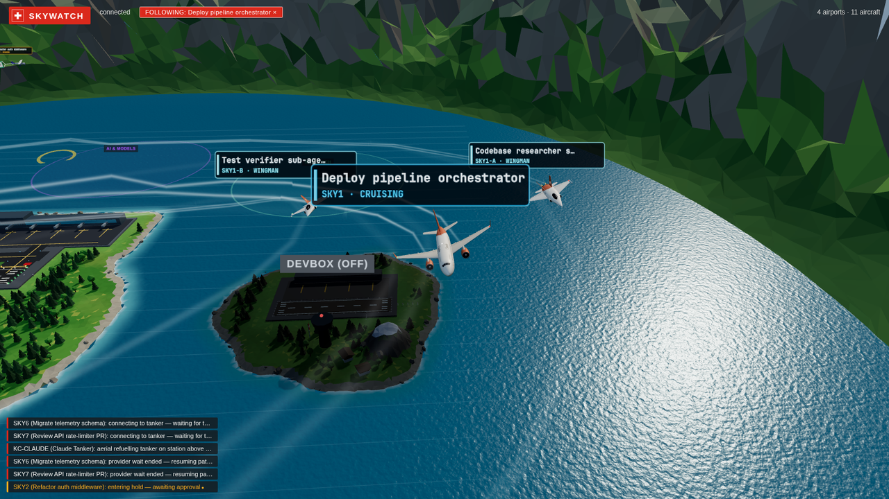
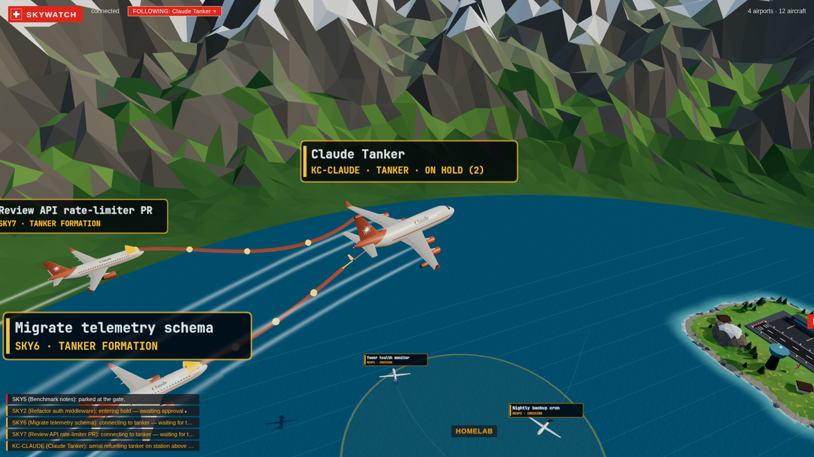
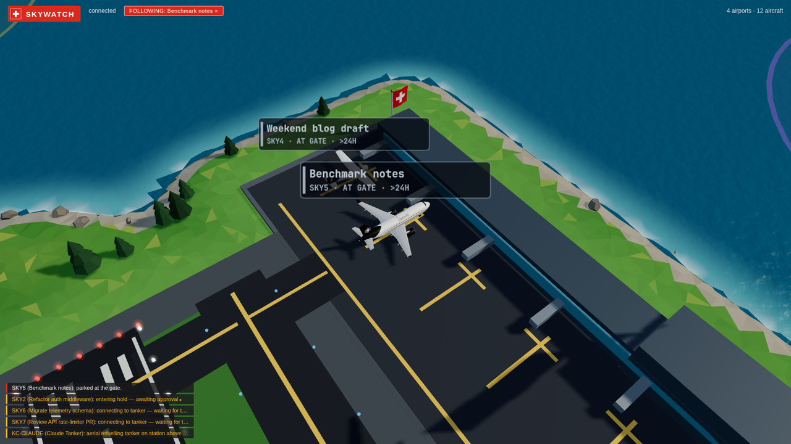

# Skywatch

A 3D air-traffic-control view of AI agent threads, sub-agents, and provider rate-limit waits — built with a Rust (`axum`) simulation server and a Three.js WebGL client.



## The Metaphor

| In the sky | What it represents |
| --- | --- |
| **Aircraft** | An active AI agent thread — single-prop tourers for local models, twin-engine jets for frontier models, and MQ-9 Reaper drones for monitoring/scheduled jobs |
| **Delta-wing fighter wingmen** | Sub-agents flying tight escort formation beside their parent aircraft |
| **Aerial refuelling tankers (`KC-*`)** | Provider rate-limit or quota-reset waits — waiting threads connect via catenary hoses and drogue baskets with glowing token-pulse beads |
| **Island airports** | Connected devices — your local machine is the central hub with Runway 36, parallel Taxiway Alpha, and a 10-gate concourse; linked environments appear as satellite islands |

## Features

- **Device Island Airports** — The local machine gets a central alpine island with a control tower, Runway 36, parallel Taxiway Alpha, south departure holding bay, and a 10-gate terminal concourse. Linked T3 environments appear as satellite islands (up to 5) that dynamically dim terrain, glass, runway lights, and banners when offline while retaining last-known aircraft state with an offline marker.
- **Airframe Classes & Provider Liveries** — Local-model agents fly as single-prop Cessna-style tourers (towing sky-banners and performing occasional barrel rolls with coloured airshow smoke); frontier-model agents fly as twin-engine jets; sub-agents scramble as delta-wing fighter jets with afterburners (up to 4 per parent); provider waits spawn 4-engine aerial refuelling tankers; monitoring jobs fly as MQ-9 Reaper drones. Every airframe is procedurally painted in its model provider's livery (Anthropic/Claude, OpenAI, Google Gemini/Gemma, DeepSeek, Z.ai/GLM, Qwen, Mistral, xAI/Grok, Meta/Llama, Moonshot/Kimi, or a generic fallback).
- **Full Flight Lifecycle & Traffic Sequencing** — Working threads patrol scenic figure-8/oval tracks across four default domain zones (`Build`, `Homelab`, `AI & Models`, `Research`) plus dynamic project sectors for named T3 projects. Threads awaiting input enter an amber holding orbit; token-limited threads rendezvous with their provider tanker; recent idle threads (<24 h) queue along Taxiway Alpha (`TX*`); stale threads untouched >24 h park at the terminal gates (`GT*`); settled or archived threads taxi out and depart into the horizon. RVSM altitude stratification, active separation, continuous climb/approach/flare/rollout transitions, volumetric landing light cones, runway chase lights, and glidepath beads keep airspace readable.
- **Live T3 Integration & Radio Panel** — Mirrors local and linked-device T3 threads (keeping parent threads airborne while sub-agents are still working), lets you send messages or approve holds from the radio panel, and links directly to conversations via **Open in T3 Web** or **Open in local harness** (`t3code://`).
- **Standalone Demo Mode** — Run `SKYWATCH_T3=0` for a self-contained scripted fleet with cruising jets, fighter wingmen, holding patterns, a refuelling tanker rendezvous, parked gate traffic, and runway takeoffs/landings.

## Screenshots

### Takeoff & Volumetric Landing Light Cone



### Follow Camera & Radio Panel



### Sub-Agent Fighter Wingmen Escort



### Provider Aerial Refuelling Formation



### Taxiway & Gate Concourse



## Architecture

```text
┌────────────────────────────────────────────────────────────────────┐
│  Browser Client (web/)                                             │
│  Three.js ES modules (no bundler) · WebGL scene · HUD & Radio UI   │
└───────────────────────────────▲────────────────────────────────────┘
                                │ HTTP (static + /health) & WebSocket (/ws, 20 Hz snapshots/deltas)
┌───────────────────────────────▼────────────────────────────────────┐
│  Skywatch Server (server/, Rust / axum / tokio)                    │
│  • 20 Hz world simulation: flight physics, RVSM separation,        │
│    taxiway routing, runway sequencing, wingmen, tankers            │
│  • Demo script (seed.rs) when SKYWATCH_T3=0                        │
│  • T3 adapter (adapters/t3.rs + remote.rs) when SKYWATCH_T3=1      │
└───────┬───────────────────────────┬────────────────────────┬───────┘
        │ bundled SQLite (RO)       │ Python t3_bridge.py    │ t3 CLI (host)
        ▼                           ▼                        ▼
  ~/.t3/userdata/             T3 MCP endpoint         Local reachability
  statev2.sqlite (RO)         (linked devices &       probe & local
                              remote thread send)     thread send
```

- **Server (`server/`)**: Single Rust binary using `axum`, `tokio`, `tower-http`, and `serde`. Owns all simulation state, ticks at 20 Hz, and broadcasts full world snapshots/deltas over `/ws` while serving static files from `web/` and a plain-text `ok` on `/health`.
- **Client (`web/`)**: Pure ES-module Three.js client with no build step. Handles exponential position/attitude interpolation, procedural aircraft geometry and provider liveries (`aircraft.js`, `livery.js`), alpine terrain and water (`alpine.js`), runway lighting and landing-light shaders (`runway-lights.js`, `runway-events.js`), local-model banners and aerobatics (`local-flair.js`), tanker countdowns (`tanker.js`), and the radio panel (`radio.js`).
- **T3 Adapter (`server/src/adapters/t3.rs`, `remote.rs`, `scripts/t3_bridge.py`)**: Polls T3 off-lock so external I/O never stalls the 20 Hz tick. Local threads, pending requests, usage-limit waits, and sub-agents are queried strictly read-only from T3's SQLite projection (`statev2.sqlite`) with a CLI fallback (`t3 thread list --json`). Linked peer environments are polled through an embedded Python 3 MCP bridge (`scripts/t3_bridge.py`) using a dedicated paired OAuth token; failed or partial peer polls retain last-known aircraft with an offline marker instead of deleting them.

## Quick Start (Demo Mode)

Requires a Rust toolchain (`cargo`). Run with `SKYWATCH_T3=0` to launch the standalone scripted demo fleet without T3:

```bash
cd server
SKYWATCH_T3=0 SKYWATCH_PORT=8422 cargo run
```

Open [http://127.0.0.1:8422](http://127.0.0.1:8422).

Or build a release binary:

```bash
cd server
cargo build --release
SKYWATCH_T3=0 SKYWATCH_PORT=8422 ./target/release/skywatch-server
```

## Live T3 Configuration

Live T3 mode is enabled by default (`SKYWATCH_T3=1`, or whenever `SKYWATCH_T3` is unset).

### Host Requirements

- T3 running locally with its projection database at `~/.t3/userdata/statev2.sqlite` (or `$T3CODE_HOME/userdata/statev2.sqlite`).
- The `t3` CLI, found on `PATH` (including the `t3.cmd` shim on Windows) or in `~/.t3/bin`, the launcher T3 Code installs. Used for linked-device reachability probes and relaying radio messages to local threads. Override with `SKYWATCH_T3_CLI`.
- Python 3 (used by the embedded MCP bridge for linked-device polling and remote message relay). Skywatch uses the first of `python3` or `python` that works, or `py -3` first on Windows. Override with `SKYWATCH_PYTHON`.

T3's projection database is read with SQLite compiled into the server, so no `sqlite3` binary is needed.

### Pairing Linked Devices (Optional)

To poll threads across linked peer environments and send messages to remote threads, pair a dedicated Skywatch MCP client once on the T3 host:

```bash
python3 scripts/pair_t3.py
```

`pair_t3.py` uses T3's local scoped session and OAuth PKCE approval endpoints to create an `approval-required` MCP client (it never starts a provider run) and saves the credential with mode `0600` at `~/.config/skywatch/t3-mcp-token`, outside the checkout. Re-run `scripts/pair_t3.py` if the token expires, or revoke the Skywatch client in T3 access settings.

Then start the server:

```bash
cd server
SKYWATCH_PORT=8422 cargo run
```

### Running on Windows

Run the server natively from PowerShell. The Docker live overlay needs host networking, which Docker Desktop on Windows doesn't provide in the same way, so use Docker only for the demo fleet.

```powershell
py scripts\pair_t3.py            # optional: linked devices
cd server
$env:SKYWATCH_HOST = "127.0.0.1"  # optional: local-only, no firewall prompt
cargo run --release
```

Building needs the Rust MSVC toolchain (its C compiler builds the bundled SQLite). Skywatch reads T3 data from `%USERPROFILE%\.t3`, finds `t3.cmd` on `PATH` or in `%USERPROFILE%\.t3\bin`, and talks to T3 on loopback without going through any configured proxy. A T3 origin of `0.0.0.0` (from `t3 --lan`) is rewritten to `127.0.0.1`, since Windows can't connect to a wildcard address.

If a work machine still doesn't connect, the server log names the cause: a missing `t3` CLI or Python, a missing or expired token, or the connection error. Point Skywatch at the right pieces with `SKYWATCH_T3_CLI`, `SKYWATCH_PYTHON`, `T3CODE_HOME`, or `SKYWATCH_T3_MCP_URL`.

### Environment Variables

| Variable | Default | Description |
| --- | --- | --- |
| `SKYWATCH_PORT` | `8422` | TCP port the HTTP/WebSocket server listens on |
| `SKYWATCH_HOST` | `0.0.0.0` | Interface to listen on. Set `127.0.0.1` to keep Skywatch local-only (this also avoids the Windows Firewall prompt) |
| `SKYWATCH_T3` | `1` (enabled) | Set to `0` or `false` to disable the T3 adapter and fall back to demo mode |
| `SKYWATCH_DEMO` | `1` (enabled) | Set to `0` or `false` to disable demo seeding when `SKYWATCH_T3=0` |
| `T3CODE_HOME` | `~/.t3` (`%USERPROFILE%\.t3` on Windows) | Base directory containing `userdata/statev2.sqlite`, `userdata/environment-id`, and `userdata/server-runtime.json` |
| `SKYWATCH_T3_MCP_URL` | from `server-runtime.json` | Explicit T3 MCP endpoint URL (e.g. `http://127.0.0.1:3773/mcp`) |
| `SKYWATCH_T3_TOKEN_FILE` | `~/.config/skywatch/t3-mcp-token` | Path to the paired MCP bearer token file |
| `SKYWATCH_T3_CLI` | found on `PATH`, then `~/.t3/bin` | Full path to the `t3` CLI, such as `t3.cmd` on Windows |
| `SKYWATCH_PYTHON` | `python3`, `python`, or `py -3` | Python 3 interpreter for the MCP bridge |
| `SKYWATCH_SUBAGENT_LINGER_SECS` | `600` | Seconds recently finished sub-agents stay on their parent's wing before peeling off |

When the number of active threads exceeds display capacity, the HUD status bar reports how many threads are omitted. Remote aircraft and actions carry both environment and thread identity so IDs never collide across devices.

## Docker Usage

The repository ships a multi-stage `Dockerfile` (digest-pinned Rust build stage with `cargo build --locked`, then a slim Debian runtime holding `skywatch-server`, `web/` assets, and `python3`), a default demo `docker-compose.yml`, and a live-T3 overlay `docker-compose.live.yml`.

Nothing credential- or database-related is baked into the image (`.dockerignore` excludes `.git`, `target/`, SQLite files, tokens, and `.env*`). The container runs as a non-root user (`UID`/`GID` 1000 by default) with a read-only root filesystem, all Linux capabilities dropped, `no-new-privileges`, and a `/health` healthcheck.

### Run Demo Fleet (No Host Access)

```bash
docker compose up -d --build           # http://127.0.0.1:8422
docker compose ps                      # shows health status
```

Compose variables:
- `SKYWATCH_PORT` — published host port (default `8422`).
- `SKYWATCH_BIND` — host bind address (default `127.0.0.1`; widen only on a trusted private network or behind an authenticating reverse proxy).
- `SKYWATCH_TAG` — image tag (default `local`).
- `SKYWATCH_UID` / `SKYWATCH_GID` — build-time and runtime UID/GID (default `1000`).

### Run with Live T3

Pair the MCP token once on the T3 host, then start with both Compose files:

```bash
python3 scripts/pair_t3.py
docker compose -f docker-compose.yml -f docker-compose.live.yml up -d --build
```

Overrides: `T3_USERDATA` (default `~/.t3/userdata`), `SKYWATCH_T3_TOKEN_PATH` (default `~/.config/skywatch/t3-mcp-token`), `SKYWATCH_T3_MCP_URL` (default `http://127.0.0.1:3773/mcp`), and `SKYWATCH_UID`/`SKYWATCH_GID` (must match the owner of those host files).

**What works from the container:**
- **Local threads**: `~/.t3/userdata` is bind-mounted read-only so the server can open `statev2.sqlite` read-only along with its adjacent `-wal`/`-shm` files. (Because the whole `userdata` directory is mounted read-only, other files in that directory are also readable inside the container.)
- **Linked devices & remote messages**: The bundled Python MCP bridge reads the paired token from a Compose secret (`/run/secrets/skywatch_t3_token`, never an image layer or environment variable) and talks to T3's loopback MCP listener via `network_mode: host`.

**What does not work from the container:**
- The host **`t3` CLI** is not included in the image, so features that shell out to it are unavailable: the periodic linked-device reachability probe (`t3 environment list`) and relaying radio messages to **local** threads (`t3 thread send`). Relaying messages to threads on linked devices goes through the MCP bridge and works.
- **`network_mode: host`** exposes `SKYWATCH_PORT` directly on all host interfaces because the server binds `0.0.0.0`. Firewall the port or restrict access to loopback/tailnet (see [Security](#security)). A bridge-networked container cannot reach T3's loopback-only MCP listener.

If the paired token expires, re-run `python3 scripts/pair_t3.py` and restart the container.

### Update & Rollback

```bash
# Update (tag each build with the commit SHA so earlier images remain available)
git pull --ff-only
SKYWATCH_TAG=$(git rev-parse --short HEAD) docker compose [-f docker-compose.yml -f docker-compose.live.yml] up -d --build

# Rollback to a previous image tag
docker image ls skywatch
SKYWATCH_TAG=<previous-sha> docker compose [-f docker-compose.yml -f docker-compose.live.yml] up -d --no-build
```

Skywatch keeps no persistent server state, so rollbacks require no data migration. Base images in `Dockerfile` are pinned by digest; to refresh them, pull the desired upstream tag, inspect its digest with `docker image inspect --format '{{index .RepoDigests 0}}' <image>`, update `Dockerfile`, and rebuild.

## Controls

### Mouse

- **Left-drag** — Orbit the camera around the overview target or the followed aircraft.
- **Scroll wheel** — Zoom in and out.
- **Right-drag** — Pan across the map (in overview mode).
- **Click an aircraft** (or click the top takeoff/arrival event banner) — Lock the follow camera onto that aircraft and open its Radio Panel.
- **Click empty sky or water** — Disengage follow camera and close the Radio Panel.

### Keyboard

| Key | Action |
| --- | --- |
| `ArrowLeft` / `ArrowRight` / `ArrowUp` / `ArrowDown` | Orbit and tilt around the overview target or the followed aircraft |
| `+` / `=` / `PageUp` | Zoom in |
| `-` / `_` / `PageDown` | Zoom out |
| `W` / `A` / `S` / `D` | Pan across the ground plane (overview mode) |
| `Home` | Glide smoothly back to the overview camera |
| `Esc` | Exit follow camera and close the Radio Panel (or unfocus the radio text box while typing) |
| `Enter` | Focus the Radio Panel message input (when an aircraft is selected) or send the current message |

### Radio Panel & Open in T3

Clicking any aircraft opens the right-hand Radio Panel, displaying its airframe class, provider livery/model, owning device, airspace zone, current flight state, and any hold reason or provider reset countdown.

- **Send a message** — Type in the message box and press `Enter` or click **Send** to relay a message back to the owning T3 thread (and wake parked/queued aircraft).
- **Approve / Reject** — Appears on `holding` aircraft awaiting input or approval.
- **Open in T3 Web** — Opens the thread at `https://app.t3.codes/threads/<environment>/<thread>` (requires access to the owning device).
- **Open in local harness** — Opens the thread via the `t3code://threads/<environment>/<thread>` desktop protocol handler.
- **Thread reference** — Expand to inspect or copy the owning environment ID and thread ID (useful when a device is offline).

## Security

> **Skywatch has NO built-in authentication or authorization.**

- **Never expose Skywatch to the public internet.** Keep it bound to `localhost` (`127.0.0.1`), inside a private tailnet/VPN, or behind a trusted authenticating reverse proxy.
- **Live mode exposes private metadata and thread controls.** In live T3 mode (`SKYWATCH_T3=1`), anyone who can reach the web UI or `/ws` endpoint can read your thread titles, project names, linked device names, and thread/environment IDs, and can send messages or approvals to active threads via the Radio Panel.
- **Host-networking caveat.** `skywatch-server` binds `0.0.0.0:<SKYWATCH_PORT>`. The default `docker-compose.yml` publishes only `127.0.0.1:${SKYWATCH_PORT:-8422}:8422`, but `docker-compose.live.yml` uses `network_mode: host` so the container can reach T3 on host loopback — make sure your host firewall blocks external access to `SKYWATCH_PORT`.
- **Keep MCP credentials private.** `scripts/pair_t3.py` writes `~/.config/skywatch/t3-mcp-token` with mode `0600` outside the repository. Never commit tokens, `.env` files, or SQLite databases, and mount only the Skywatch token (not an entire provider home directory) when running in containers.

## Tests

```bash
cd server
cargo test
```
